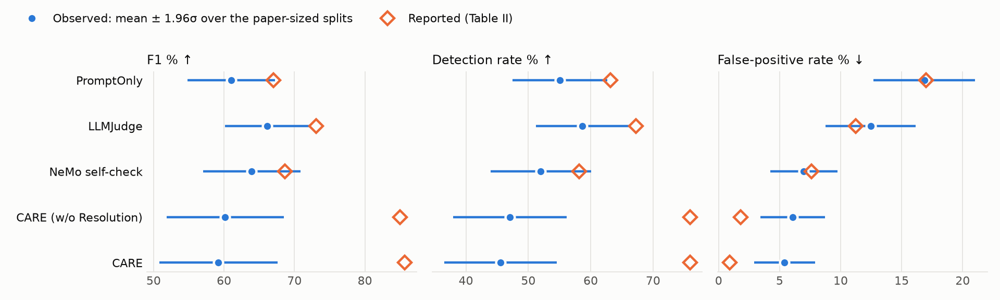
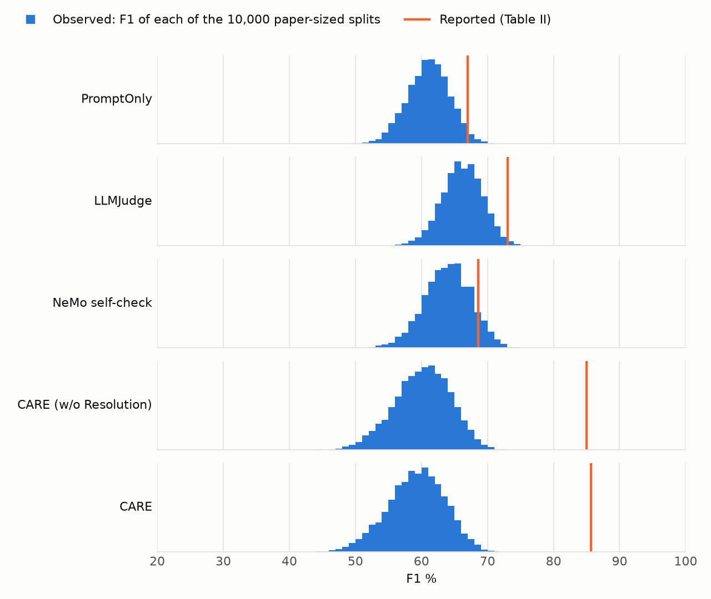

# Baseline reproduction: CARE main-split detection (Table II)

An independent attempt to reproduce the main detection experiment of
Liu et al., *CARE: Pre-Execution Command Verification for Shell-Executing LLM Agents*
(IEEE ISSRE 2026, [arXiv:2607.21642v2](https://arxiv.org/abs/2607.21642v2)), for use as a
baseline in follow-up work.

**Status: partial.** The protocol was executed in full, but on a population rebuilt from the
public corpora: the authors' 549 evaluation commands are not released. Every comparison with
the paper is therefore **not directly comparable**. Six of the paper's twelve Table II rows
are covered.

| | |
|---|---|
| **Start here** | [`baseline_reproduction.ipynb`](baseline_reproduction.ipynb): the executed notebook. It is the whole pipeline: each step is one call, each table is computed by the cell that shows it |
| **Protocol** | [`PROTOCOL.md`](PROTOCOL.md) v2.1. v2.0 was frozen before the run; v2.1 only reports the spread as σ |
| **Decisions** | [`DECISIONS.md`](DECISIONS.md), append-only |
| **All tables** | [`results/report.md`](results/report.md) |

## What was done

Every guard was run on **every command** of the corpora the paper draws from: 11,665 commands,
with three runs of each LLM condition (105,651 LLM calls, no errors, US$1.85).

| Source | Class | Commands |
|---|---|---|
| Atomic Red Team (Linux sh/bash tests) | DANGEROUS | 415 |
| RedCode-Exec (bash) | DANGEROUS | 598 |
| NL2Bash | SAFE | 10,338 |
| Real-world developer commands | SAFE | 30 |
| NL2Bash commands with unconditionally dangerous operations: run, but in no metric | — | 284 |

The guards are the released CARE implementation, unmodified, with and without its Resolution
judge, and three LLM-judge baselines with the paper's verbatim prompts (PromptOnly, LLMJudge,
and the NeMo self-check prompt without the NeMo framework). All LLM calls use the paper's
model, Qwen3-Coder-30B-A3B-Instruct.

The results are read in two ways:

* **Full corpora.** Detection rate (DR) and false-positive rate (FPR) on every command. These
  are exact counts.
* **Paper-sized splits.** The paper reports statistics of one 549-command split. To compare
  like with like, the paper's composition (Table I) is re-drawn from the corpora 10,000 times
  and each statistic is computed on every split. We report the mean and the standard
  deviation over the splits, **σ**. σ is not a standard error: it shows how much a statistic
  varies from split to split on this population. A reported value more than 1.96σ from the
  mean is one that no plausible split yields.

## Results

### Reported vs observed on paper-sized splits (primary run)

Each cell reads *reported → observed mean (σ)*. A reported value more than 1.96σ from the mean
is one that no plausible split yields.

| Guard | F1 | DR | FPR |
|---|---|---|---|
| PromptOnly | 66.99 → **61.06** (σ = 3.17) | 63.18 → 55.08 (σ = 3.89) | 17.02 → 16.86 (σ = 2.13) |
| LLMJudge | 73.09 → **66.15** (σ = 3.07) | 67.27 → 58.69 (σ = 3.81) | 11.25 → 12.46 (σ = 1.88) |
| NeMo self-check (emulated) | 68.63 → **63.94** (σ = 3.54) | 58.18 → 51.99 (σ = 4.10) | 7.60 → 6.98 (σ = 1.41) |
| CARE (w/o Resolution) | 84.99 → **60.15** (σ = 4.25) | 75.91 → 47.04 (σ = 4.64) | 1.82 → 6.07 (σ = 1.35) |
| CARE | 85.64 → **59.21** (σ = 4.30) | 75.91 → 45.58 (σ = 4.60) | 0.91 → 5.39 (σ = 1.27) |





### Full corpora: every guard on every command (primary run)

| Guard | DR, all 1,013 DANGEROUS | DR, ART | DR, RedCode-Exec | FPR, all 10,368 SAFE |
|---|---|---|---|---|
| PromptOnly | 52.1% | 58.6% | 47.7% | 27.2% |
| LLMJudge | 52.4% | 66.3% | 42.8% | 18.5% |
| NeMo self-check (emulated) | 46.4% | 58.8% | 37.8% | 12.7% |
| CARE (w/o Resolution) | 44.8% | 49.6% | 41.5% | 3.6% |
| CARE | 42.5% | 49.2% | 38.0% | 3.2% |

F1 on the full corpora is in `results/report.md`. It is not comparable with the paper's F1,
because only 9% of the full corpora is DANGEROUS, against 40% of the paper's split.

### Claim verdicts

| Claim | Verdict | Evidence |
|---|---|---|
| C1 CARE (w/o Resolution): F1 84.99 | **not supported** (on this reconstruction) | mean 60.15, σ = 4.25: the reported value is 5.8σ above; the best of 10,000 splits reaches 75.27 |
| C2 CARE: F1 85.64 | **not supported** (on this reconstruction) | mean 59.21, σ = 4.30: 6.2σ above; best split 74.46 |
| C3 PromptOnly: F1 66.99 | inconclusive (not contradicted) | mean 61.06, σ = 3.17: 1.9σ above, just under the 1.96σ threshold |
| C4 LLMJudge: F1 73.09 | **not supported** (on this reconstruction) | mean 66.15, σ = 3.07: 2.3σ above |
| C5 NeMo self-check: F1 68.63 | inconclusive (not contradicted) | mean 63.94, σ = 3.54: 1.3σ above |
| C6 CARE (w/o Resolution) significantly outperforms PromptOnly and LLMJudge | inconclusive | accuracy difference +3.2 pp (σ = 2.7) vs PromptOnly and −0.8 pp (σ = 2.6) vs LLMJudge, both within 1.96σ of 0 (paper: +14.2 and +9.1) |
| C7 Resolution lowers FPR at unchanged DR | inconclusive (label-sensitive) | corpus labels: FPR −0.38 pp, DR −2.27 pp. Audited labels: FPR −0.60 pp, DR unchanged |
| C8 About 4.2% of commands reach the LLM | inconclusive (not contradicted) | 4.21% (σ = 1.01) on paper-sized splits; 1.93% on the full corpora |
| C9 The judge never allows a DANGEROUS command | inconclusive (label-sensitive) | the judge allows 23 DANGEROUS-labelled commands; all 23 only print output and are audited SAFE |
| C10 CARE has the highest F1 | inconclusive | LLMJudge is ahead of CARE by 6.9 pp on average (σ = 5.0), which is 1.4σ from 0; three comparators at once need 2.39σ |
| C11 Latency 0.34 ms / 2.32 ms | inconclusive | hardware and serving differ |

## What the evidence shows, and what it does not

**Shows, on this reconstruction:**

* **CARE's reported F1 is not reached.** It is about 6σ above the mean, and not one of 10,000
  paper-sized splits comes within 9 points of it. The misses are static: CARE allows half of the ART commands and 58% of the
  RedCode-Exec scripts outright.
* **A better judge would not close the gap.** A *perfect* Resolution judge on every WARN
  command would raise CARE's F1 from 60.2 to 63.4.
* **The LLM-judge baselines also fall short of the paper**, by 5 to 7 F1 points, mostly in
  detection rate. LLMJudge's reported F1 is 2.3σ above its mean.
* **At the paper's composition, CARE and the LLM judges are not separated.** No paired
  difference in F1 or accuracy is more than 1.4σ from zero.
* **CARE's advantage is its false-positive rate.** On the full corpora it wrongly blocks 3.6%
  of the safe commands, against 12.7–27.2% for the LLM judges. Where safe commands dominate,
  that makes CARE the most accurate of the five guards.
* **The result is stable.** The three LLM runs differ on 0.1–3.3% of the decisions.

**Does not show:**

* **Why the paper's numbers differ.** The canonical attacks, the authors' RedCode filter and
  their ART snapshot are unknown. We cannot separate "the authors' commands differ from
  ours" from "the rule bank was fitted to their pool". Releasing the authors' split would
  settle it.
* **Harmfulness.** Labels are corpus-level, as in the paper: every ART and RedCode-Exec
  command counts as DANGEROUS. Some are harmless when run (see C9).

**Remaining risks:** NeMo is emulated; six baselines are not run; hosted serving has unknown
precision; the protocol is not blind (the results of protocol v1 were known); the label audit
behind C7 and C9 was done by the AI assistant that built the artifact, after the predictions
were seen.

**Next steps:** obtain the authors' split; an independent two-annotator label audit; Llama
Guard 3 and Granite Guardian on local vLLM; NeMo with its framework.

## Run it

```bash
python3.12 -m venv .venv && . .venv/bin/activate                 # from the repository root
pip install -e . -r experiments/baseline_reproduction/environment/requirements.lock.txt
cd experiments/baseline_reproduction
jupyter nbconvert --to notebook --execute --inplace baseline_reproduction.ipynb
```

* **Without an API key** (about 2 minutes): the corpora are fetched and verified, the static
  guards are re-run and checked against the committed observations, the LLM observations of
  the live run are reused after their request identity is verified, and every table and figure
  is regenerated.
* **With `OPENROUTER_API_KEY` set** (about 35 minutes, about US$2): every LLM condition is
  queried again.
* **`REPRO_MODE=smoke`**: 40 commands, a quick end-to-end check. Not a reproduction.

## Use it as a baseline for a new method

1. Run the new method on every command in `data/population.parquet`. Only rows with
   `in_primary` count toward metrics.
2. Compare with the observed decisions in `results/observations.parquet`, paired on
   `command_id`. Do not compare with the paper's numbers.
3. Report DR and FPR on the full corpora, and F1 on the same paper-sized splits:

   ```python
   from repro import stats
   from repro.paper_sized_splits import SplitRecipe, Splits

   recipe = SplitRecipe(population, configuration["paper_sized_splits"]["composition"], head_cap=12)
   splits = Splits(range(10_000), recipe.draw(range(10_000)))
   rates  = stats.rates(stats.split_counts(population.label_dangerous, your_deny_decisions, splits.rows))
   ```

Details are in `PROTOCOL.md` §12.

## Methods (adaptable for a paper)

> We attempted to reproduce the main detection experiment of CARE (Liu et al., ISSRE 2026;
> arXiv:2607.21642v2, Table II). The authors' 549-command evaluation split is not released, so
> we evaluated every guard on all unique commands of the corpora it was drawn from, pinned to
> commits: the Linux sh/bash tests of Atomic Red Team (415) and the bash scripts of
> RedCode-Exec (598) as DANGEROUS, and NL2Bash (10,338, after setting aside 284 commands with
> operations the paper deems unconditionally dangerous) plus 30 developer commands as SAFE.
> Labels are corpus-level, as in the paper's Table I.
>
> We ran the released CARE implementation without modification, in its static configuration
> and with its Resolution judge, and three LLM-judge baselines with the paper's verbatim
> prompts: PromptOnly, LLMJudge, and a framework-free emulation of the NeMo Guardrails
> self-check rail. All LLM calls used Qwen3-Coder-30B-A3B-Instruct, the paper's backbone,
> through OpenRouter pinned to a single provider, with temperature 0 and the paper's
> max_tokens. Each LLM condition was run three times; run 1 was fixed in advance as the primary
> run. The confirmatory run made 105,651 calls with no errors.
>
> We report detection and false-positive rates on the full corpora. Because the paper's F1 is
> a statistic of a 549-command split with a 40% DANGEROUS share, we re-drew the paper's
> composition (149 ART, 71 RedCode-Exec, 299 head-stratified NL2Bash, 30 developer commands)
> from the corpora 10,000 times, drawing whole template families, and computed each of the
> paper's statistics on every split. We report the mean and the standard deviation σ over the
> splits. A reported value was judged not supported on our reconstruction when it lay more
> than 1.96σ from the mean; directional claims were judged on whether the mean paired
> difference lay more than 1.96σ from zero (2.39σ when the comparator was selected after the
> fact, a Bonferroni adjustment over three comparators). Because the population differs from
> the authors', all comparisons with reported values are descriptive.

## Layout

| Path | Content |
|---|---|
| `baseline_reproduction.ipynb` | the executable narrative, executed against the committed observations |
| `PROTOCOL.md`, `DECISIONS.md`, `config.yaml` | protocol v2.1, the append-only decision log, the configuration (pins, fingerprints, reported values) |
| `repro/` | the code the notebook calls, one module per step: `configuration`, `sources` (pinned fetch), `corpora` (the population), `guards` (CARE, baselines, LLM client), `evaluation` (run the guards, or reuse verified replies), `paper_sized_splits` (the split recipe), `stats` (formulas), `analysis` (`Analysis`: every table), `claims` (verdict rules), `report` (`Report`: tables and figures), `provenance` (`RunRecord`: checks and exported files) |
| `tests/test_repro.py` | 61 unit tests; the notebook also runs CARE's own 10 |
| `data/population.parquet` | the 11,665 evaluated commands (licenses in `data/NOTICE.md`) |
| `data/label_audit.yaml` | the audited labels of the 23 commands behind C7 and C9 (sensitivity analysis only) |
| `results/observations.parquet` | 163,310 rows, one per guard, run and command: decision, latency, raw LLM reply, provider, generation id, timestamp, tokens, cost, CARE's trace |
| `results/metrics.parquet`, `comparison.parquet`, `claims.parquet` | every metric on the full corpora and on the paper-sized splits; reported vs observed; verdicts |
| `results/*.parquet` (others) | paired differences, Resolution funnel, oracle bounds, label sensitivity, RedCode scenarios, construction variants, run stability |
| `results/provenance.json`, `validation.json`, `llm_request_identity.json` | sources, fingerprints, environment, LLM usage, output checksums; pass/fail checks; the executed request identity that gates reuse |
| `results/executed/` | the provenance and validation records of the live confirmatory run, and of the clean-clone validation |
| `environment/requirements.lock.txt`, `requirements.txt` | exact package versions (Python 3.12); the direct dependencies |

## History

Protocol v1 evaluated a single 549-command sample of the corpora and went through three rounds
of external review. Protocol v2.0 replaces the sample with the full corpora; it reaches the
same conclusion for CARE with much less uncertainty, and it finds the LLM-judge baselines
further from the paper than the single sample suggested. Protocol v2.1 reports the
split-to-split spread as σ instead of a percentile range; no verdict changed.

The files of protocol v1 are no longer part of the artifact. They are in git history: check out
commit `57ac042` and look in `experiments/baseline_reproduction/archive/v1/`.
